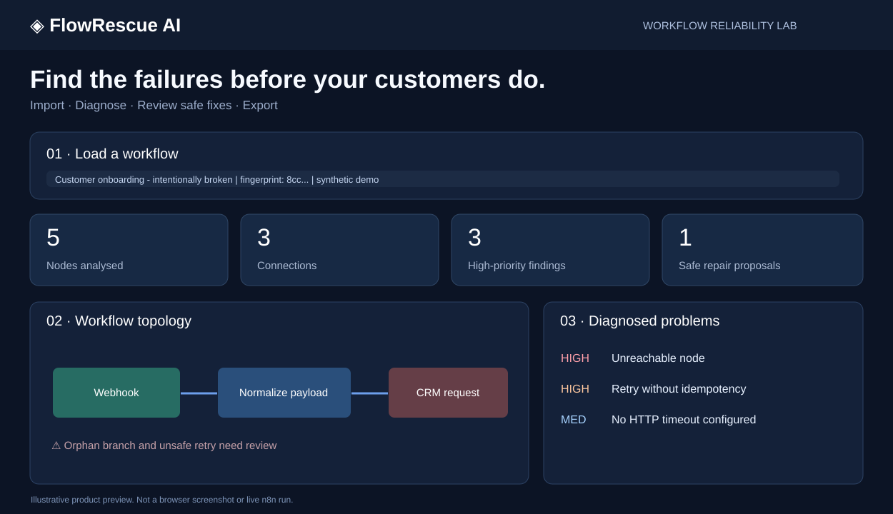
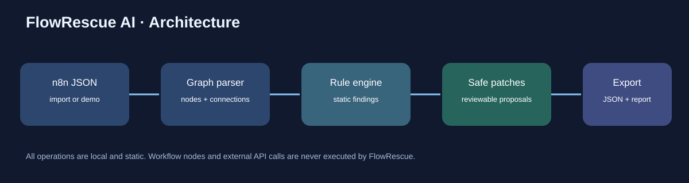
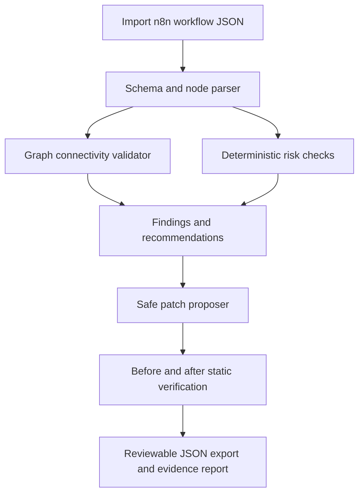

# FlowRescue AI

**Find the failures before your customers do.** An open-source, local-first **n8n workflow static analyser** with an interactive graph, deterministic risk rules, conservative repair proposals, fault-scenario flags, and downloadable JSON evidence.



> The preview image is a design illustration, **not** a captured screenshot. The web dashboard runs the included analysis API on your machine. The tool does **not** execute n8n workflows, inject real network faults, connect to production n8n instances, or guarantee workflow safety.

## Why build this?

An agency can import a client workflow and identify disconnected branches, broken references, missing request timeouts, suspicious inline credentials and risks from retrying mutations without idempotency. It generates reviewable, minimal changes and preserves original JSON for comparison. It **does not** claim to fix all problems automatically.

## Architecture





## Run locally

Python 3.10 or newer recommended.

```bash
python -m venv .venv
source .venv/bin/activate   # Windows: .venv\\Scripts\\activate
pip install -r requirements.txt
uvicorn flowrescue.web:app --host 127.0.0.1 --port 8080
```

Open **http://127.0.0.1:8080** and click **Load broken demo**. Or run with Docker:

```bash
docker compose up --build
```

The demo loads `examples/broken-workflow.json`, an intentionally flawed n8n customer-intake workflow. No credentials or paid AI provider are required. Upload your own workflow JSON to analyse it. Do **not** import real credentials or secrets into untrusted sites.

## Demo in 90 seconds

1. Open the dashboard and click **Load broken demo**.
2. Inspect the interactive workflow topology and disconnected metrics node.
3. Review HTTP timeout and unsafe POST retry findings.
4. Inspect the suggested **10,000 ms timeout** patch. Other high-risk issues remain flagged for manual action.
5. Click **Export repaired JSON** to download a conservative proposed patch, or **Download report** for a detailed JSON report.
6. Compare `examples/broken-workflow.json`, `examples/proposed-repair.json`, and `reports/demo-evidence.json`.

The example CRM URL uses `example.invalid` on purpose and must be configured to a real, authorised test endpoint before manual testing in n8n. Do not activate it as a production workflow.

## Supported analysis rules

| Rule | Meaning | Repair behaviour |
|---|---|---|
| `NO_TRIGGER` | No recognised trigger node | Manual |
| `MISSING_SOURCE` / `MISSING_TARGET` | Connection to absent node | Manual |
| `UNREACHABLE` | Branch unreachable from triggers | Manual |
| `DISCONNECTED` | Non-trigger node has no incoming edge | Manual |
| `HTTP_URL_MISSING` | HTTP endpoint unset | Manual |
| `HTTP_TIMEOUT` | No explicit HTTP timeout | **Proposes 10-second timeout** |
| `HTTP_RETRY` | HTTP retry disabled | Manual: retries may be unsafe |
| `RETRY_IDEMPOTENCY` | POST/PUT/PATCH with retries | Manual: use idempotency keys |
| `POSSIBLE_INLINE_SECRET` | Parameter resembles literal token | Manual: rotate and use credentials |
| `CODE_REVIEW` | Certain dynamic Code node patterns | Manual |
| `CYCLE_REVIEW` | Directed graph cycle | Manual |

Rules are **heuristics**, not complete n8n semantic validation. Static absence of a finding is not a guarantee. Scenario checks explicitly report only whether the corresponding static rule fired.

## API

- `GET /health` — service health and mode declaration
- `GET /api/demo` — sample workflow
- `POST /api/analyze` — findings and node/edge counts
- `POST /api/scenarios` — static fault-condition checks
- `POST /api/repair` — minimally patched workflow with structured change log
- `POST /api/report` — analysis and before/after verification report
- `GET /docs` — FastAPI's interactive OpenAPI documentation

POST format: `{"workflow": <imported n8n workflow JSON>}`. API request bodies are limited at the application workflow level by node count, but this is not a hardened internet-facing multi-tenant API.

## Verification

```bash
pip install -r requirements-dev.txt
pytest -q
```

The test suite includes nine tests spanning graph findings, safe repair immutability, a clean baseline, broken edges, credential heuristics, input errors, and the HTTP API. The report file in `reports/` is generated by the local core logic—not invented sample counts.

## Security and limitations

- Run locally or behind authenticated access. **Do not expose the API publicly without access control, size-limiting reverse proxy, and a security review.**
- The app does not execute user-submitted code, LLM prompts, workflow nodes, or external APIs. Workflow JSON is analysed in memory.
- Changes are suggestions downloaded as JSON, **never deployed automatically**.
- Some n8n node schemas and parameters vary by version. Import the JSON into a safe, isolated n8n instance and inspect changes before use.
- No authenticated n8n API monitoring, browser-recorded live screenshots, AI-generated freeform fixes, real fault injection, or certified production deployment are included in v0.1.

## Tech stack

Python · FastAPI · deterministic graph analysis · local HTML/CSS/JS dashboard · Pytest · Docker

## References

- [n8n API reference](https://docs.n8n.io/api/api-reference/)
- [n8n executions documentation](https://docs.n8n.io/workflows/executions/)

## License

MIT — see [LICENSE](LICENSE).

## Deploy the interactive demo to Vercel

This repository includes root `app.py`, which exposes the existing FastAPI application for Vercel's Python runtime. No external database or API key is required; the analyzer is stateless. You can import this repository into Vercel and select **Other** as the framework if automatic detection does not identify FastAPI. Leave the root directory at the repository root. Click **Deploy**, then verify `/`, `/health`, `/api/demo` and the analysis interface.

The Vercel deployment is a public demo of **static** n8n JSON analysis: it does not connect to n8n, run workflows, or alter production integrations. Do not upload real workflows containing credentials or sensitive business information into a publicly hosted application. Vercel account/project configuration, rate limits, and production hardening need review before handling real customer data.

For a short Loom: show the homepage, click *Load broken demo*, explain the flags, run suggested repair, and download the report. Use the synthetic built-in workflow only.
